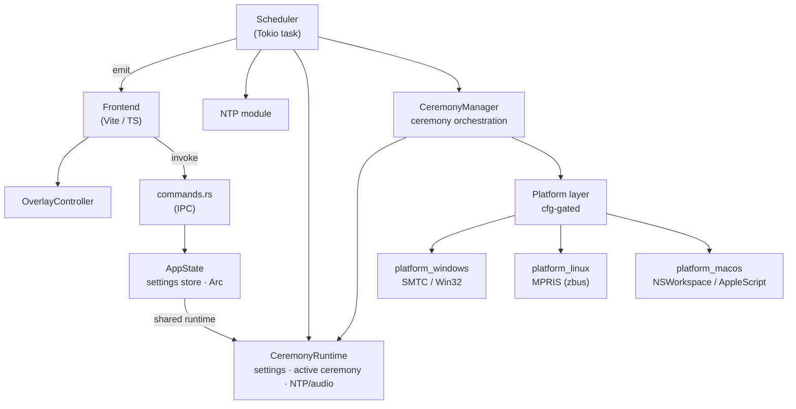

# Architecture

## Overview



## Key design decisions

### Why Tauri instead of Electron?
Tauri's Rust backend gives us direct access to Win32, Linux, and macOS system APIs without an extra IPC layer, and the resulting binary is ~5 MB vs ~150 MB for an equivalent Electron app.

### Shared ceremony runtime
The scheduler runs as a long-lived Tokio task. It and the Tauri commands share a `CeremonyRuntime`, which holds settings, the current run, and the NTP and audio engines. The settings store remains owned by `AppState`.

On Android, the preparation alarm starts `CeremonyService`, which starts the same Rust scheduler over JNI even when there is no Activity. The runtime reads the persisted Tauri settings and uses the application-scoped Android audio host. The Android Activity attaches to the running runtime instead of creating another scheduler. A scheduled run records its start on disk so restarting the process does not replay it that day.

On Android, playback does not open the app or depend on notification permission. The visual overlay and anthem flag animation are desktop-only, even if imported settings enable them.

### Targeted media pausing instead of system-wide key emulation
Earlier designs simulated media key events (such as `VK_MEDIA_PLAY_PAUSE`), but this was prone to toggling state on already-paused players or failing under certain window focus conditions. Now, the app uses native platform APIs to query active media sessions and pause/resume them selectively:
- **Windows:** System Media Transport Controls (`GlobalSystemMediaTransportControlsSessionManager`)
- **Linux:** MPRIS D-Bus interface (`zbus`)
- **macOS:** AppleScript control of running media apps (`osascript` via `NSWorkspace`)
Active players are tracked dynamically and restored precisely when the ceremony ends.

Android requests transient audio focus when pausing other players is enabled. The ceremony releases its request at the end, after restoring volume and mute; each player decides whether to resume. The desktop resume setting does not apply on Android.

### Settings persistence
Settings are serialised as pretty-printed JSON to the platform config directory:
- **Windows:** `%APPDATA%\minute-of-silence\settings.json`
- **Linux:** `~/.config/minute-of-silence/settings.json`
- **macOS:** `~/Library/Application Support/minute-of-silence/settings.json`

### NTP Synchronization Strategy
The app supports both system clock and NTP-corrected time. A manual synchronization feature is provided via a dedicated `sync_ntp_now` IPC command that updates the shared state and triggers immediate correction.

### Native Look & Feel
To ensure the application feels like a native desktop tool:
- **Text Selection:** Disabled globally via CSS.
- **Context Menu:** Standard browser context menu is blocked.
- **Typography:** Uses a high-quality monospace font stack (Ubuntu Mono, JetBrains Mono, etc.).

## Data flow: ceremony trigger

```
Scheduler loop (every 1 s)
  ├─ sync_ntp() if needed          ← hourly or on sleep resume
  └─ get_synchronized_now()        ← NTP-corrected or system clock
       └─ Should trigger today?
            ├─ Compensation window: [09:00 - compensation, 09:00)  ← opening voice/bell + 1 s pause before the metronome
            └─ Grace window: [09:00, 09:00 + grace_minutes)        ← late start / wake up
                 └─ trigger_ceremony() (CeremonyManager)
                      ├─ Set ceremony_active = true & last_activation = now
                      ├─ On desktop, register anthem-start/end listeners (if flag animation and visual overlay are enabled & blocks contain the anthem)
                      ├─ emit("ceremony-start", { duration_ms })   → Desktop frontend can show overlay
                      ├─ On desktop, pause other players (if enabled)
                      ├─ Auto-unmute & set system volume priority
                      ├─ On Android, request temporary audio focus (if enabled)
                      ├─ audio_engine.play_blocks(...)             → Runs on a dedicated thread
                      └─ finish_ceremony()                         ← Called when audio ends
                           ├─ Restore system volume & mute states
                           ├─ On desktop, resume paused players (if enabled)
                           ├─ On Android, release this ceremony's audio focus
                           ├─ Clear settings.skip_date from store
                           └─ emit("ceremony-end")                 → Desktop frontend hides overlay
```
